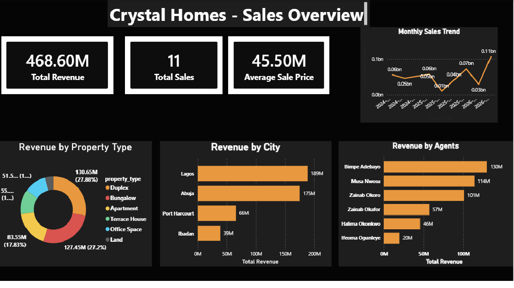
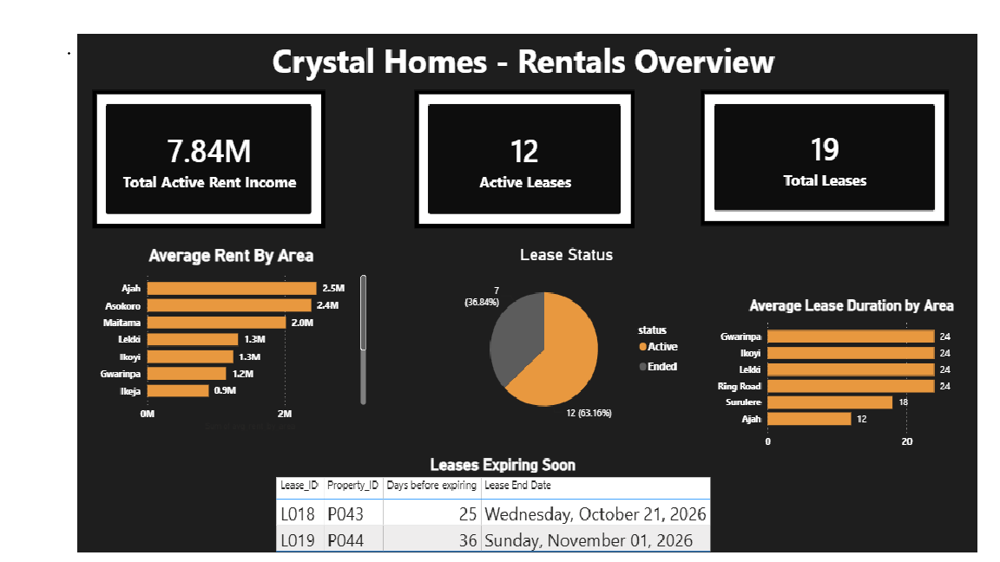
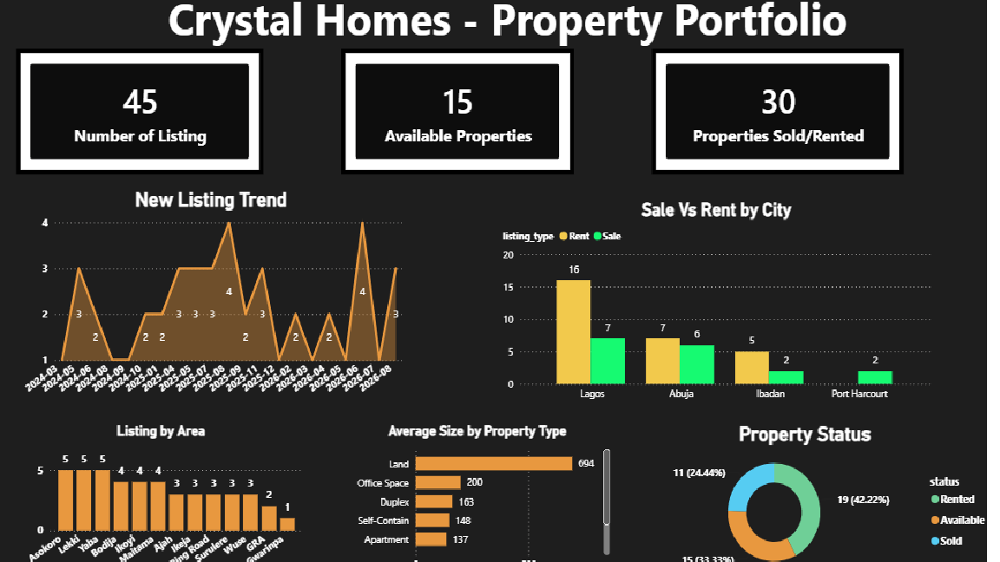

# Crystal Homes and Real Estate Management

A combined **property sales + rental analytics** project built for a fictional Nigerian real estate agency operating across Lagos, Abuja, Port Harcourt, and Ibadan.

**Pipeline:** Google Sheets (raw data) → MySQL (schema + 21 SQL views) → Power BI (4-page interactive dashboard)

---

## Business Problem

Crystal Homes needed a single view of performance across both its **sales** and **rental** portfolios — revenue by location and property type, lease income and renewal risk, listing activity, and agent/branch performance — to support decisions on where to expand, which agents are top performers, and which leases need attention before they expire.

---

## Data Model

Five related tables, built and queried in MySQL:

| Table | Description |
|---|---|
| `properties` | 45 listings — city, area, type, size, listing price/type, status |
| `agents` | 8 agents across 4 branches |
| `clients` | 40 clients — buyers and tenants |
| `sales` | 11 completed sales, linked to property/agent/client |
| `leases` | 19 leases (12 Active, 7 Ended), linked to property/agent/client |

All relationships enforced with foreign keys (`property_id`, `agent_id`, `client_id`).

---

## SQL

All table creation and analytical logic is in [`crystal_homes_all_queries.sql`](./crystal_homes_all_queries.sql) — **21 views** answering 20 business questions across 6 sections:

1. Database + table setup
2. Sales analytics (Q1–Q6) — revenue by city/area/type, price comparison, monthly trend, agent performance
3. Rental analytics (Q7–Q12) — active income, lease status, expiry tracking, average rent, lease duration
4. Property portfolio analytics (Q13–Q17) — listing trends, status breakdown, size by type
5. Agent & branch performance (Q18–Q19) — combined sales + rental revenue per agent, branch totals
6. Client analytics (Q20) — buyer/tenant split by city

Key SQL techniques used: `GROUP BY` with multiple columns, `DATE_FORMAT()` for monthly bucketing, `DATEDIFF()` / `TIMESTAMPDIFF()` for expiry and duration calculations, `LEFT JOIN` subqueries with `COALESCE()` for combining sales and rental revenue per agent.

---

## Dashboard

Built in Power BI, dark theme with amber (`#E8983F`) accents. Four pages, each answering a distinct set of business questions.

### 1. Sales Overview

- **₦468.6M** total revenue across 11 sales, **₦45.5M** average sale price
- Duplexes are the top-performing property type by revenue
- Lagos and Abuja lead by city (₦189M and ₦175M)
- Bimpe Adebayo is the top-performing agent by revenue

### 2. Rentals Overview

- **₦7.84M** in active monthly rent income across **12 active leases** (19 total)
- 2 leases are expiring within the next 90 days — flagged in a dedicated table for renewal follow-up
- Ajah and Asokoro command the highest average rents
- Lease duration varies by area: premium areas (Lekki, Ikoyi, Gwarinpa, Ring Road) average 24-month leases vs. 12 months elsewhere

### 3. Property Portfolio

- 45 total listings — 15 Available, 30 Sold/Rented
- Lagos dominates rental listings (16 properties)
- Land has the largest average size (694 sqm) among property types

### 4. Agent & Client Insights

- 8 agents, 40 clients (7 buyers, 12 tenants in Lagos alone)
- Bimpe Adebayo leads combined agent revenue; one agent (Adaeze Adebayo, Ibadan branch) shows ₦0 in sales — she manages an active lease instead, so this reflects a rentals-only role rather than a data issue
- Abuja leads branch revenue at ₦0.26bn, despite Ibadan properties selling — see insight below

---

## Key Insight: Branch Revenue ≠ Property Location

While validating the dashboard, Ibadan's branch showed **₦0 revenue** even though Ibadan properties had sold. Investigating this surfaced an important nuance in the data model: **branch performance is attributed to the agent's home branch, not the property's city.** Two Ibadan properties were sold by Lagos-based agents, so that revenue is correctly counted under Lagos in the branch performance view (`vw_q19_branch_performance`), not Ibadan.

This isn't a bug — it reflects how real estate agencies often operate (agents can close deals outside their home branch) — but it's a distinction worth knowing when reading the "Revenue by Branch" chart: it measures **agent branch performance**, not **market performance by city**. Market-level revenue by location is more accurately read from the Sales Overview page instead.

---

## Tools Used

- **MySQL** — schema design, data import, 21 analytical views
- **Power BI** — ODBC connection to MySQL, 4-page interactive dashboard
- **Google Sheets** — raw data staging before import

---

## Author

Built by Adama as part of an ongoing data analytics portfolio.
